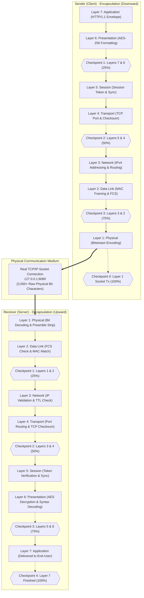

# OSI 7-Layer Network Model Simulation

A full implementation of the **OSI 7-Layer Network Architecture** featuring **C-based Client and Server applications** communicating over **real TCP/IP network sockets**, coupled with an interactive **Python User Application** that visualizes the **zig-zag data flow** and reports networking progress **after every two OSI layers**, mirroring modern Linux/Ubuntu kernel networking stacks.

[](https://en.wikipedia.org/wiki/C_(programming_language))
[](https://python.org)
[](https://en.wikipedia.org/wiki/OSI_model)
[](https://en.wikipedia.org/wiki/Network_socket)
[](https://ubuntu.com)
[](LICENSE)

---

## Submission & Project Metadata

- **Student / PC Username:** `MD Akib Al Jawad`
- **GitHub Repository URL:** [https://github.com/jawad-i/OSI-model](https://github.com/jawad-i/OSI-model)
- **Reference Article:** [The OSI Model Explained: Key Layers in Computer Networking](https://dev.to/iaadidev/the-osi-model-explained-key-layers-in-computer-networking-53b7)
- **Base Architecture Reference:** [jsramesh1990 / OSI_Communication_Simulation_Project](https://github.com/jsramesh1990/OSI_Communication_Simulation_Project)

---

## Terminal Verification Screenshot

The screenshot below validates the complete live simulation execution, displaying the PC username (`MD Akib Al Jawad`), date and time, GitHub repository, real socket transmission, and the 7-layer progress checkpoints:


---

## Architecture & Zig-Zag Data Flow

In computer networking, data moves in a **U-shaped "Zig-Zag" pattern**:
1. **Encapsulation (Sender / Client Stack):** Data begins at the Application layer (Layer 7) and travels **downward** to Layer 1. Each layer prepends its respective header and control metadata.
2. **Physical Transmission (Network Wire):** The Physical layer transforms frames into raw bitstreams (`0`s and `1`s) transmitted across real TCP/IP sockets (`127.0.0.1:8080`).
3. **Decapsulation (Receiver / Server Stack):** The bitstream enters at the Physical layer (Layer 1) and travels **upward** to Layer 7. Each layer inspects, validates, and strips its protocol header before passing the payload to the next higher layer.



---

## Checkpoint Tracking After Every Two OSI Layers

Similar to production Linux networking kernels (`sk_buff` lifecycle and netfilter hook points), this simulation enforces modular inspection checkpoints after every **two OSI layers**:

### Encapsulation Flow (Downward: 7 → 1)
| Stage | Layers Processed | Description | Progress |
| :---: | :--- | :--- | :---: |
| **Stage 1** | **Layer 7 & 6** | Application payload generated and Presentation syntax formatted / encrypted | `25% [##........]` |
| **Stage 2** | **Layer 5 & 4** | Session dialog initialized and TCP segments framed with ports & checksum | `50% [#####.....]` |
| **Stage 3** | **Layer 3 & 2** | IPv4 packet addressed and Ethernet frame sealed with MAC & FCS | `75% [#######...]` |
| **Stage 4** | **Layer 1** | Frame converted to bitstream with preamble and transmitted via socket | `100% [##########]` |

### Decapsulation Flow (Upward: 1 → 7)
| Stage | Layers Processed | Description | Progress |
| :---: | :--- | :--- | :---: |
| **Stage 1** | **Layer 1 & 2** | Bitstream converted to bytes; Ethernet MAC and FCS CRC checked | `25% [##........]` |
| **Stage 2** | **Layer 3 & 4** | IPv4 destination verified; TCP port and segment checksum validated | `50% [#####.....]` |
| **Stage 3** | **Layer 5 & 6** | Session dialogue acknowledged; Presentation payload decrypted | `75% [#######...]` |
| **Stage 4** | **Layer 7** | Application payload delivered intact to target user application space | `100% [##########]` |

---

## 7-Layer Implementation Breakdown

| Layer | Name | C Functions | Envelope / Header Data | Responsibility |
| :---: | :--- | :--- | :--- | :--- |
| **7** | **Application** | `layer7_application_send`<br/>`layer7_application_recv` | `[APP\|PROTO=HTTP/1.1\|DATA=...]` | End-user interface, HTTP message creation |
| **6** | **Presentation** | `layer6_presentation_send`<br/>`layer6_presentation_recv` | `[PRES\|ENC=AES256\|COMPR=OFF\|...]` | Data encryption, compression, formatting |
| **5** | **Session** | `layer5_session_send`<br/>`layer5_session_recv` | `[SESS\|ID=0x5A1B\|SYNC=TRUE\|...]` | Dialog control, session synchronization token |
| **4** | **Transport** | `layer4_transport_send`<br/>`layer4_transport_recv` | `[TCP\|SRC_PORT=54321\|DST_PORT=8080\|...]` | Port addressing, TCP checksum, segmenting |
| **3** | **Network** | `layer3_network_send`<br/>`layer3_network_recv` | `[IP\|VER=4\|SRC=192.168.1.100\|TTL=64\|...]` | Logical routing, IPv4 addressing, TTL checks |
| **2** | **Data Link** | `layer2_datalink_send`<br/>`layer2_datalink_recv` | `[ETH\|SMAC=...\|DMAC=...\|FCS=0x....]` | MAC addressing, Ethernet framing, FCS CRC |
| **1** | **Physical** | `layer1_physical_send`<br/>`layer1_physical_recv` | `10101010101010110101101101000101...` | Binary bitstream encoding & Socket wire transmission |

---

## Project Structure

```text
OSI-model/
├── src/
│   ├── osi_layers.h           # Layer declarations, packet structures & socket headers
│   ├── osi_layers.c           # 7-layer encapsulation & decapsulation implementations
│   ├── client.c               # C Client (Sender: Encapsulation & socket transmission)
│   ├── server.c               # C Server (Receiver: Socket listening & Decapsulation)
│   └── osi_simulation.c       # Standalone all-in-one C simulation pipeline
├── python/
│   ├── visualizer.py          # Professional Python Rich Dashboard: Animated zig-zag & stack progress
│   ├── osi_model_data.py      # Layer data models, educational explanations & header structures
│   └── capture_screenshot.py  # Automated high-res terminal screenshot generator
├── tests/
│   ├── test_communication.bat # Automated test suite for Windows
│   └── test_communication.sh  # Automated test suite for Linux/Ubuntu
├── screenshots/
│   └── osi_simulation_screenshot.png # Verification screenshot with username & timestamp
├── docs/
│   └── OSI_Model.md           # Comprehensive OSI theoretical documentation
├── Makefile                   # Cross-platform build script (Windows / Linux)
├── README.md                  # Complete project documentation
└── LICENSE                    # MIT License
```

---

## Build & Installation

### Prerequisites
- **GCC / Clang:** MinGW-w64 on Windows (`gcc.exe`) or GCC on Ubuntu (`sudo apt install build-essential`)
- **Python:** Python 3.8+ (`python3` or `py`)
- **Python Libraries:** `rich` (required for dashboard), `pillow` (for screenshot generation)
  ```bash
  pip install rich pillow
  ```
- **Make:** GNU Make (optional)

### 1. Compiling the C Applications

#### On Windows (PowerShell / Command Prompt):
```powershell
# Using GCC directly with Winsock
New-Item -ItemType Directory -Force bin
gcc -Wall -Wextra -Isrc src/osi_layers.c src/osi_simulation.c -o bin/osi_sim.exe -lws2_32
gcc -Wall -Wextra -Isrc src/osi_layers.c src/client.c -o bin/osi_client.exe -lws2_32
gcc -Wall -Wextra -Isrc src/osi_layers.c src/server.c -o bin/osi_server.exe -lws2_32
```

#### On Linux / Ubuntu:
```bash
make all
```

---

## Running the Simulation

### Option A: Interactive Python Visualizer (Zig-Zag Flow)

Run the Python application to see the real-time animated zig-zag diagram and progress updates:

```bash
# Animated demonstration mode
python python/visualizer.py

# Custom message with custom speed
python python/visualizer.py --message "Testing custom network payload" --speed 0.2

# Live mode: Runs real compiled C client and server binaries over sockets
python python/visualizer.py --live --message "Hello from MD Akib Al Jawad"
```

### Option B: Real Client / Server Socket Communication

Open two terminals:

**Terminal 1 (Start Server / Receiver):**
```bash
# Windows
.\bin\osi_server.exe 8080

# Linux
./bin/osi_server 8080
```

**Terminal 2 (Start Client / Sender):**
```bash
# Windows
.\bin\osi_client.exe "Hello OSI Network! Live Socket Communication" 127.0.0.1 8080

# Linux
./bin/osi_client "Hello OSI Network! Live Socket Communication" 127.0.0.1 8080
```

### Option C: Standalone C Simulation Pipeline

```bash
# Windows
.\bin\osi_sim.exe "Single pipeline test across all 7 layers"

# Linux
./bin/osi_sim "Single pipeline test across all 7 layers"
```

---

## Automated Test Suites

Both Windows and Linux automated test scripts are provided to verify standalone simulation, real socket communication, and the Python visualizer:

```powershell
# On Windows
tests\test_communication.bat
```

```bash
# On Linux / Ubuntu
chmod +x tests/test_communication.sh
./tests/test_communication.sh
```

---

## Author & Acknowledgments

- **Developed By:** MD Akib Al Jawad
- **GitHub Repository:** [https://github.com/jawad-i/OSI-model](https://github.com/jawad-i/OSI-model)
- **Coursework:** Computer Networks & Data Communications / OSI Layer Simulation Project
- **Standards:** ISO/IEC 7498-1 Open Systems Interconnection Standard
- **License:** [MIT License](LICENSE)
