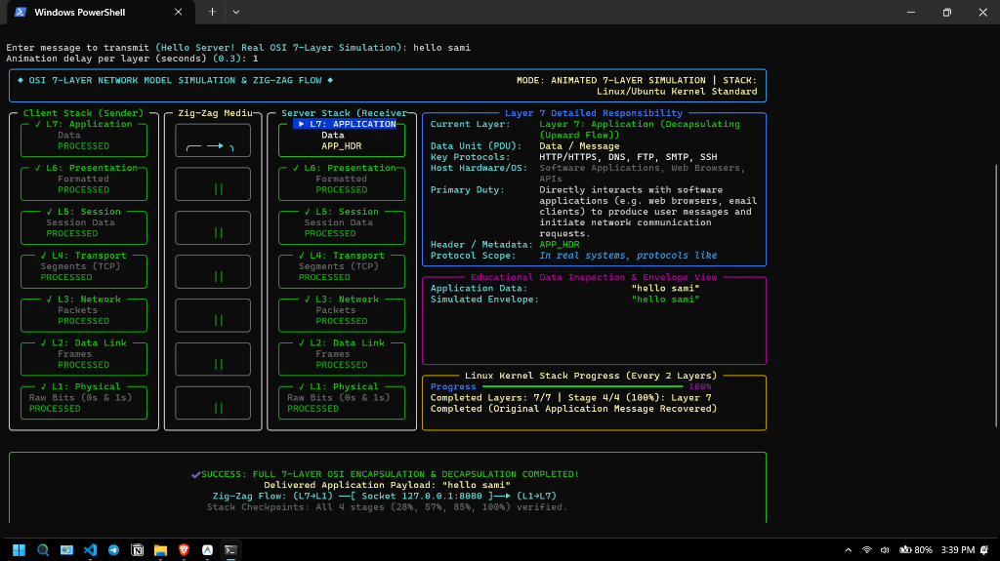

# OSI 7-Layer Model Simulation Project

**Author:** MD Akib Al Jawad  
**Course:** Computer Networks & Data Communications  
**Repository:** [https://github.com/jawad-i/OSI-model](https://github.com/jawad-i/OSI-model)  

---

## About This Project

This is my live project for the Computer Networks course. The goal was to build a hands-on simulation of the complete ISO 7-layer OSI model to see how data actually gets packaged, transmitted across a network, and unpacked on the other side.

Instead of just printing static text, this project combines two core parts:
1. **C Programs (`client.c` & `server.c`):** Implements real socket communication over TCP (port 8080). The client encapsulates user data from Layer 7 down to Layer 1, sends thousands of raw physical bit characters over the socket, and the server decapsulates it back up from Layer 1 to Layer 7.
2. **Python Visualizer (`visualizer.py`):** An animated terminal interface built with Rich that visually tracks the classic **zig-zag data flow** (downward on the sender side, across the socket wire, and upward on the receiver side), updating progress checkpoints after every two OSI layers.

---

## Submission Screenshot

Here is the terminal verification screenshot from my PC showing my username (`MD Akib Al Jawad`), the date, timestamp, and the simulation running end-to-end:



---

## How It Works: The Zig-Zag Flow

In real networking, communication between two hosts doesn't happen in a straight line—it follows a **U-shaped / zig-zag path**:

```text
       SENDER (Client)                              RECEIVER (Server)
┌────────────────────────────┐                ┌────────────────────────────┐
│ Layer 7: Application       │                │ Layer 7: Application       │ ◀── Delivered!
│ Layer 6: Presentation      │                │ Layer 6: Presentation      │
├────────────────────────────┤                ├────────────────────────────┤
│ [Check 1: 28% Done]        │                │ [Check 3: 85% Done]        │
├────────────────────────────┤                ├────────────────────────────┤
│ Layer 5: Session           │                │ Layer 5: Session           │
│ Layer 4: Transport (TCP)   │                │ Layer 4: Transport (TCP)   │
├────────────────────────────┤                ├────────────────────────────┤
│ [Check 2: 57% Done]        │                │ [Check 2: 57% Done]        │
├────────────────────────────┤                ├────────────────────────────┤
│ Layer 3: Network (IP)      │                │ Layer 3: Network (IP)      │
│ Layer 2: Data Link (MAC)   │                │ Layer 2: Data Link (MAC)   │
├────────────────────────────┤                ├────────────────────────────┤
│ [Check 3: 85% Done]        │                │ [Check 1: 28% Done]        │
├────────────────────────────┤                ├────────────────────────────┤
│ Layer 1: Physical (Bits)   │ ──[ SOCKET ]─▶ │ Layer 1: Physical (Bits)   │
└────────────────────────────┘  (127.0.0.1)   └────────────────────────────┘
        ▼ Encapsulation (Down)                      ▲ Decapsulation (Up)
```

1. **Client Encapsulation (L7 &rarr; L1):**  
   The sender takes your original message (e.g. `"Hello Server!"`) and adds headers as it moves downward:
   - **Layer 7 (Application):** Formats the application payload `[APP|HTTP/1.1|DATA=...]`.
   - **Layer 6 (Presentation):** Applies simulated AES-256 formatting `[PRES|ENC=AES256|...]`.
   - *&rarr; Checkpoint 1 (28%): Layers 7 & 6 completed.*
   - **Layer 5 (Session):** Adds session token and sync checkpoint `[SESS|ID=0x5A1B|...]`.
   - **Layer 4 (Transport):** Adds TCP header with source/dest ports (54321 &rarr; 8080) and 16-bit checksum.
   - *&rarr; Checkpoint 2 (57%): Layers 5 & 4 completed.*
   - **Layer 3 (Network):** Adds IPv4 routing info (`192.168.1.100` &rarr; `192.168.1.200`, TTL=64).
   - **Layer 2 (Data Link):** Adds MAC addresses (`00:1A:..` &rarr; `AA:BB:..`) and FCS error-checking CRC.
   - *&rarr; Checkpoint 3 (85%): Layers 3 & 2 completed.*
   - **Layer 1 (Physical):** Converts the entire Ethernet frame into raw binary bits (`10101010...`) with a 16-bit preamble.
   - *&rarr; Checkpoint 4 (100%): Layer 1 completed, ready for wire transmission.*

2. **Real Socket Transmission:**  
   The client connects to `127.0.0.1:8080` over a real TCP socket and sends the raw physical bitstream.

3. **Server Decapsulation (L1 &rarr; L7):**  
   The server reads the bitstream from the socket, strips headers in reverse order (L1 &rarr; L7), verifies checksums at each stage, and delivers the original message intact to the application.

---

## Project Structure

```text
OSI-model/
├── src/
│   ├── osi_layers.h           # Header declarations and cross-platform socket setup
│   ├── osi_layers.c           # 7-layer encapsulation & decapsulation logic
│   ├── client.c               # C client: encapsulates L7->L1 and transmits over socket
│   ├── server.c               # C server: listens on 8080 and decapsulates L1->L7
│   └── osi_simulation.c       # Standalone all-in-one C simulation
├── python/
│   ├── visualizer.py          # Rich terminal dashboard with zig-zag animation & menu
│   ├── osi_model_data.py      # Layer definitions and educational descriptions
│   └── capture_screenshot.py  # Script used to generate the submission screenshot
├── tests/
│   ├── test_communication.bat # Automated test script for Windows
│   └── test_communication.sh  # Automated test script for Linux
├── screenshots/
│   └── osi_simulation_screenshot.png # Verification screenshot with username & timestamp
├── docs/
│   └── OSI_Model.md           # Reference notes on the OSI model
├── Makefile                   # For building with GCC / Make
└── README.md                  # Project documentation
```

---

## How to Run It

### Prerequisites
- **GCC:** MinGW on Windows or standard GCC on Linux
- **Python 3.8+** with `rich` and `pillow` installed:
  ```bash
  pip install rich pillow
  ```

---

### Method 1: The Interactive Python Visualizer (Easiest)

Just run the visualizer directly from your terminal:

```bash
python python/visualizer.py
```

This opens an interactive menu where you can:
- **[1] Run Animated Simulation:** Watch the full zig-zag animation with custom messages.
- **[2] Run Real Socket Communication:** Spawns the compiled C server and client over real TCP sockets.
- **[3] Explore the 7-Layer Guide:** Quick reference table explaining each layer's role and protocols.
- **[4] Run Automated Tests:** Runs the full test suite.

You can also run specific modes using command line flags:
```bash
# Direct animated demo
python python/visualizer.py --demo

# Demo with custom message and speed
python python/visualizer.py --demo --message "Testing OSI simulation" --speed 0.2

# Live mode (executes compiled C client + server over socket)
python python/visualizer.py --live
```

---

### Method 2: Running C Client and Server in Two Terminals

If you want to see the real C programs communicate across two separate terminal windows:

**1. Compile the C files:**
```bash
# On Windows (PowerShell):
gcc -Wall -Wextra -Isrc src/osi_layers.c src/server.c -o bin/osi_server.exe -lws2_32
gcc -Wall -Wextra -Isrc src/osi_layers.c src/client.c -o bin/osi_client.exe -lws2_32

# On Linux:
make all
```

**2. Open Terminal 1 (Start the Server):**
```bash
# Windows
.\bin\osi_server.exe 8080

# Linux
./bin/osi_server 8080
```

**3. Open Terminal 2 (Run the Client):**
```bash
# Windows
.\bin\osi_client.exe "Hello from Akib!" 127.0.0.1 8080

# Linux
./bin/osi_client "Hello from Akib!" 127.0.0.1 8080
```

---

### Method 3: Standalone C Simulation (Single Process)

```bash
# Windows
.\bin\osi_sim.exe "My test message"

# Linux
./bin/osi_sim "My test message"
```

---

### Method 4: Automated Test Scripts

To run all tests in one go:

```bash
# Windows
tests\test_communication.bat

# Linux
chmod +x tests/test_communication.sh
./tests/test_communication.sh
```

---

## References

- [The OSI Model Explained: Key Layers in Computer Networking](https://dev.to/iaadidev/the-osi-model-explained-key-layers-in-computer-networking-53b7) by Aadi Dev
- ISO/IEC 7498-1 Open Systems Interconnection Basic Reference Model
- [Beej's Guide to Network Programming](https://beej.us/guide/bgnet/) for socket programming concepts

---

**Developed by MD Akib Al Jawad**  
*Feel free to star or fork the repo if you find it helpful!*
